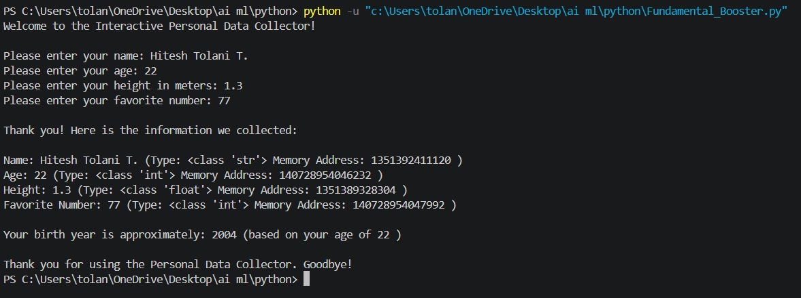

# Fundamental Booster  

## Interactive Personal Data Collector

A simple Python program that collects personal information and displays data types and object identities.
It also calculates an approximate birth year based on the user's age.

## Output Screenshot

