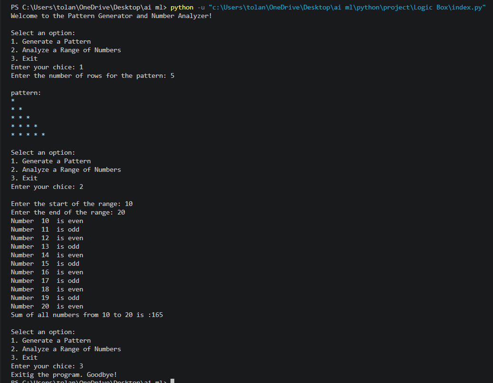

# Pattern Generator and Number Analyzer

This is a simple Python program that provides two useful features. It can generate a pattern of asterisks based on the number of rows you enter, and it can analyze a range of numbers by telling you whether each number is even or odd.

You can choose an option from the menu, enter the required inputs, and view the results directly in the console. The number analysis option also calculates the sum of all numbers in the selected range.

